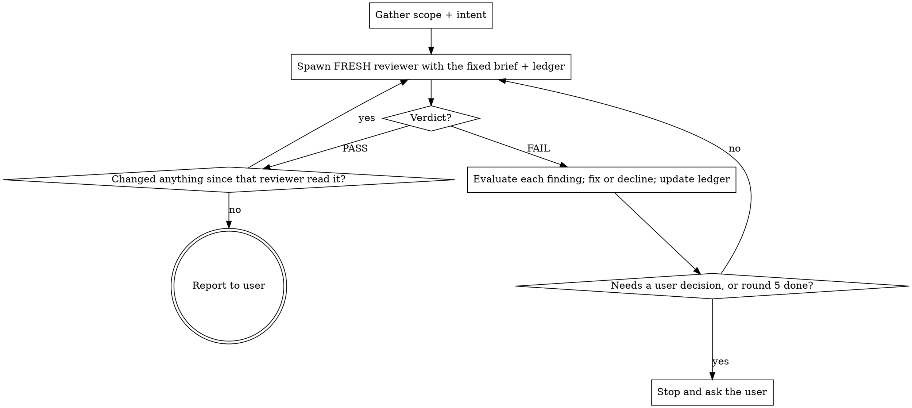

# Review Loop

You are the implementer. Your work is finished; now a fresh adversarial reviewer agent judges it, you address its findings, and you repeat until a reviewer returns `VERDICT: PASS` on the **final** state of the work.

**The PASS must be earned, not negotiated.** A PASS obtained by steering the reviewer is worthless and is worse than an honest FAIL.

## The Loop



### 1. Gather scope and intent

- **Scope:** you work out exactly what the reviewer must see, and pass it as concrete values:
  - `<paths>`: the files and directories this session changed. Never include the user's unrelated dirty or untracked files.
  - `<start>`: `git merge-base <base> HEAD`. `<base>` is what the user named, else `git symbolic-ref --short refs/remotes/origin/HEAD`, else `main`/`master`. If HEAD is on the base branch, use the commit before this session's work began; if unsure, ask the user.
  - The diff command `git diff <start-sha> -- <paths>` (committed + uncommitted, but **not** untracked files).
  - New files: `git ls-files --others --exclude-standard -- <paths>`. The reviewer reads these whole.
  - Outside git: the list of files you changed.
- **Intent:** what the user asked for, in their words. Not your opinion of how it went.
- **Spec:** paths to any plan, spec, ticket, or acceptance criteria, plus explicit non-goals, if they exist.
- **Guidelines:** any URL/file/checklist the user passed. The reviewer reads it itself.

### 2. Spawn a fresh reviewer each round

New Agent call every round (`general-purpose`), never `SendMessage` to a prior reviewer. Use the brief below **unchanged across rounds** except the ledger; changing the bar mid-loop is moving the goalposts.

Before spawning, snapshot the work: save `git diff <start-sha> -- <paths>` and `shasum` of each new file to your scratchpad. Wait for the reviewer's result before touching anything, then compare against the snapshot. If the reviewer changed anything, stop and show the user; don't auto-revert.

A missing or malformed verdict line means re-spawn with the same brief; that retry doesn't count as a round.

### 3. Handle findings

Evaluate each finding technically (**REQUIRED SUB-SKILL:** superpowers:receiving-code-review). Fix it, or decline it with a concrete reason. Record both in the ledger. Severity doesn't decide whether you address a finding; merit does. A real minor that's cheap to fix gets fixed, and a wrong major gets declined. But an unresolved blocker/major means another FAIL, so declining one needs evidence (a command and its output, or a quoted spec line), not just argument. The next reviewer sees the ledger and **judges your declines**: a sound decline is not a blocker; a weak one is.

If a finding needs a decision only the user can make (breaking change, product/API choice, history rewrite, a conflict between the spec and the tests, or a fix that requires changing what a test asserts), **stop the loop and ask the user.** Do not carve it out of the next review. Do the same when a finding keeps coming back or flip-flops between rounds.

Don't commit, amend, or push unless the user asked for that; leave fixes in the working tree.

### 4. Finish

A PASS ends the loop: stop changing code. Minor/nit findings from the passing round go in your report as open items; offer to fix them (which means another round).

Report: rounds run, each verdict, what changed, the final ledger, open items, and anything left for the user. If round 5 ends without a PASS, stop, report the sticking points, and ask whether to continue. Five fresh reviews that still disagree usually means a finding is circling on judgment rather than a fixable defect, which the user should settle.

## Reviewer Brief

```
You are an adversarial reviewer. Find real problems; you are not here to approve.
Do NOT modify any files.

Work under review, in <repo path>:
- Run `git diff <start-sha> -- <paths>`
- Also read these new files whole: <untracked list, or "none">
(Outside git: read these files: <file list>)
What the user asked for: <intent, user's words>
Spec / acceptance criteria: <"none" | paths>. Non-goals: <"none" | list>.
Guidelines to review against: <"none" | URL/file — fetch and read it yourself>.

Confirm each requirement is met and nothing outside the task changed.
Only problems this work introduced or made worse count. Note pre-existing
issues and anything beyond the request in one line as out of scope; they
never block.

Verify claims by running code/tests where possible. Read surrounding code for context.

Ledger from earlier rounds (judge it — do not take it on trust):
<"none" | list: finding → FIXED (how) | DECLINED (reason)>

Output, in this order:
1. First line exactly `VERDICT: PASS` or `VERDICT: FAIL`.
2. Numbered findings: severity (blocker/major/minor/nit), location,
   evidence (input → observed vs expected), suggested fix.
3. For each DECLINED ledger item: ACCEPT or REJECT the reasoning, and why.
Blocker/major needs a concrete trigger: an input, state, or command that
produces wrong behaviour, a requirement from the intent/spec that isn't met,
or a guideline you can quote that the work breaks. Hypotheticals, style
preferences, and defensive code for impossible cases are minor at most.
PASS only if there are no blocker/major findings and no REJECTed declines.
If the work is sound, PASS is the correct answer.
```

## Red Flags: You Are Gaming the Reviewer

| Thought | Reality |
|---|---|
| "I'll tell it this issue is already known so it doesn't count" | That's suppression. Put it in the ledger as DECLINED with a reason, or ask the user. |
| "Reword the brief so it's less strict this round" | Same brief every round. |
| "Tiny tweak after the PASS, no need to re-review" | The PASS covered a different state. Another round. |
| "Reuse the last reviewer, it has context" | It's anchored on its own review. Fresh agent. |
| "Mention I'm confident / the tests pass" | Your confidence isn't evidence. Give intent and scope only. |
| "These minors are the reviewer being picky; I'll quietly skip them" | On FAIL, record every finding as FIXED or DECLINED. On PASS, report them as open items. |
